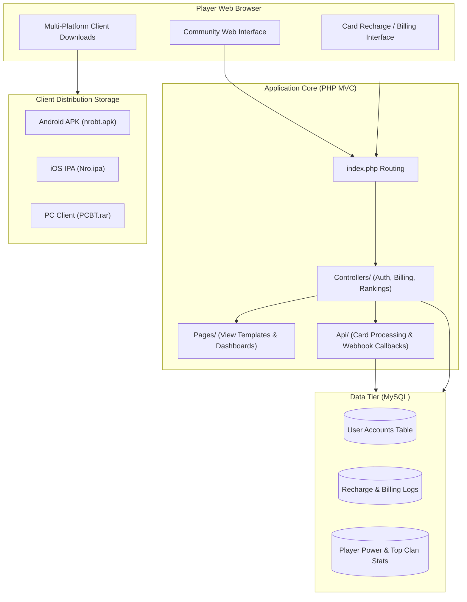

# Ngọc Rồng Online (NRO) — Official Web Portal & Billing Gateway

[](https://www.php.net/)
[](https://www.mysql.com/)
[](https://developer.mozilla.org/en-US/docs/Web/JavaScript)
[](https://developer.mozilla.org/en-US/docs/Web/CSS)

> Full-featured community web portal, billing gateway, player dashboard, and multi-platform client distribution system for the **Ngọc Rồng Online (Dragon Boy)** MMORPG server.

---

## 1. System Architecture



---

## 2. Key Modules & Features

* **Account Management & Authentication**:
  * Player registration and credential management synchronized directly with the game database.
  * Password hashing and session security.
* **Automated Billing & Card Recharge Gateway**:
  * Integration with telecom scratch card APIs (Viettel, Mobifone, Vinaphone) and payment gateway webhooks.
  * Real-time currency (Ngọc xanh, Thỏi vàng) credited to player accounts upon transaction confirmation.
* **Live Community Leaderboards**:
  * Top Power, Top Level, and Top Clan rankings dynamically queried and cached from MySQL.
* **Multi-Platform Client Distribution**:
  * Hosts verified game client packages for Android (`.apk`), iOS (`.ipa`), and Windows PC (`.rar`).
* **Client-Side Protection**:
  * Security obfuscation (`block.js`) preventing devtools tampering, inspect-element abuse, and automated scrapers.

---

## 3. Tech Stack

| Domain | Technology |
| :--- | :--- |
| **Backend** | PHP 7.4+ / 8.x (MVC pattern) |
| **Database** | MySQL 5.7+ / MariaDB 10.4+ |
| **Frontend** | HTML5, CSS3 Responsive Layout, JavaScript (Vanilla ES6) |
| **Web Server** | Apache (`.htaccess`) & IIS (`web.config`) |

---

## 4. Getting Started

### Prerequisites
- PHP 7.4+ with `pdo_mysql`, `curl`, `json` extensions
- MySQL 5.7+ (running with database matching your game server)
- Web server (Apache, Nginx, or XAMPP)

### Installation
1. Clone the repository into your web root (e.g. `htdocs/`):
   ```bash
   git clone https://github.com/btoan2802/nro-web.git
   ```
2. Configure database credentials in `Bkt.php` or configuration files.
3. Access via browser at `http://localhost/nro-web`.

---

## 5. Author & License

- **Author**: Nguyễn Bảo Toàn ([@btoan2802](https://github.com/btoan2802))
- **License**: Educational / Proprietary
